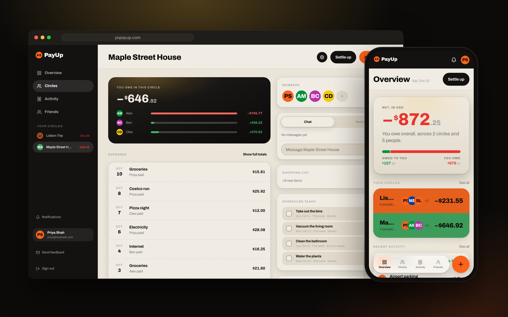

# PayUp

**Shared expenses that get split right, in any currency**

**[Read the case study →](https://github.com/CB-viberrr/portfolio/blob/main/case-studies/payup.md)** · [Live](https://yopayup.com)

- **One typed sentence or a receipt photo becomes a correctly split expense,** across 162 currencies and 5 languages.
- **An AI assistant can operate it safely:** 17 MCP tools behind PayUp's own OAuth server; it can read and file, never settle.
- **Built like a product, not a demo:** 377 commits and 85 merged pull requests in 25 active days, 60 test files gated in CI.

---
This repository is a showcase: the code is private. A walkthrough or read access is available on request.
More work: [portfolio](https://github.com/CB-viberrr/portfolio) · © 2026 Charles Bingaman
